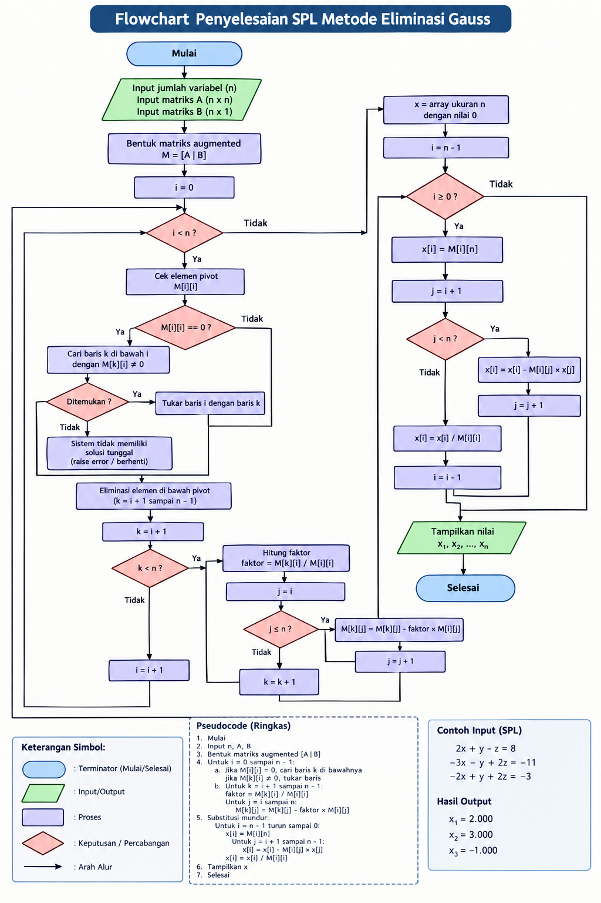

# Program Penyelesaian SPL Metode Eliminasi Gauss

## 1. Deskripsi

Program ini digunakan untuk menyelesaikan Sistem Persamaan Linear (SPL)
menggunakan metode Eliminasi Gauss dengan bahasa pemrograman Python.

## 2. Tujuan

Menyelesaikan SPL dengan melakukan eliminasi terhadap elemen-elemen
di bawah pivot hingga membentuk matriks segitiga atas, kemudian
menentukan nilai variabel menggunakan substitusi mundur.

## 3. Algoritma Deskriptif

1. Mulai.
2. Masukkan matriks koefisien A dan matriks hasil B.
3. Bentuk matriks augmented [A | B].
4. Tentukan elemen pivot.
5. Jika pivot bernilai nol, lakukan pertukaran baris.
6. Eliminasi elemen di bawah pivot hingga bernilai nol.
7. Ulangi proses sampai terbentuk matriks segitiga atas.
8. Lakukan substitusi mundur.
9. Tampilkan nilai setiap variabel.
10. Selesai.

## 4. Pseudocode

ALGORITMA ELIMINASI GAUSS

Deklarasi:
    A : matriks koefisien
    B : matriks hasil
    M : matriks augmented
    x : array solusi
    n : jumlah variabel
    i, j, k : integer
    faktor : real

Deskripsi:

Mulai

Input matriks A
Input matriks B

Gabungkan A dan B menjadi matriks augmented [A | B]

Untuk i = 0 sampai n-1:
    Jika M[i][i] = 0:
        Cari baris di bawahnya
        Jika ditemukan:
            Tukarkan baris

    Untuk k = i+1 sampai n-1:
        faktor = M[k][i] / M[i][i]

        Untuk j = i sampai n:
            M[k][j] = M[k][j] - faktor × M[i][j]

Lakukan substitusi mundur:

Untuk i = n-1 turun sampai 0:
    Hitung nilai x[i]

Tampilkan nilai x

Selesai

## 5. Flowchart

## 6. Kode Phyton

import numpy as np

def eliminasi_gauss(A, B):
    A = np.array(A, dtype=float)
    B = np.array(B, dtype=float).reshape(-1, 1)

    # Membentuk matriks augmented [A | B]
    M = np.hstack((A, B))
    n = len(B)

    # Proses eliminasi
    for i in range(n):

        # Mengecek pivot
        if abs(M[i][i]) < 1e-12:
            for k in range(i + 1, n):
                if abs(M[k][i]) > 1e-12:
                    M[[i, k]] = M[[k, i]]
                    break
            else:
                raise ValueError(
                    "Sistem tidak memiliki solusi tunggal."
                )

        # Eliminasi elemen di bawah pivot
        for k in range(i + 1, n):
            faktor = M[k][i] / M[i][i]

            for j in range(i, n + 1):
                M[k][j] -= faktor * M[i][j]

    # Substitusi mundur
    x = np.zeros(n)

    for i in range(n - 1, -1, -1):
        jumlah = 0

        for j in range(i + 1, n):
            jumlah += M[i][j] * x[j]

        x[i] = (M[i][n] - jumlah) / M[i][i]

    return M, x

# Contoh SPL
A = [
    [2, 1, -1],
    [-3, -1, 2],
    [-2, 1, 2]
]

B = [8, -11, -3]

# Menjalankan program
matriks_akhir, solusi = eliminasi_gauss(A, B)

print("Matriks setelah Eliminasi Gauss:")
print(np.round(matriks_akhir, 3))

print("\nHasil Penyelesaian SPL:")

for i, nilai in enumerate(solusi):
    print(f"x{i+1} = {nilai:.3f}")

## 7. Hasil Running

Matriks setelah proses Eliminasi Gauss:
[[ 2.   1.  -1.   8. ]
 [ 0.   0.5  0.5  1. ]
 [ 0.   0.  -1.   1. ]]

Hasil Penyelesaian SPL:
x1 = 2.000
x2 = 3.000
x3 = -1.000

## 7. Kesimpulan

Metode Eliminasi Gauss dapat digunakan untuk menyelesaikan
Sistem Persamaan Linear dengan mengubah matriks augmented
menjadi bentuk segitiga atas dan dilanjutkan dengan substitusi
mundur.

